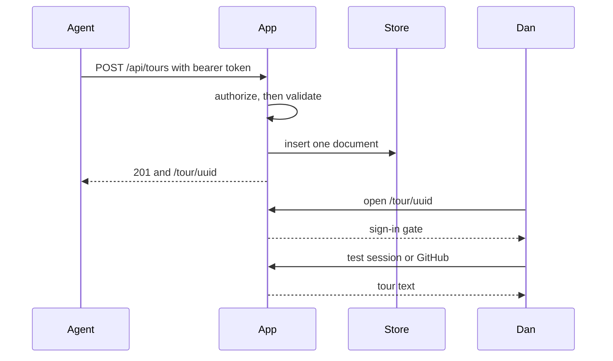

# Publish and read a private tour

An agent can publish a short private tour, and Dan can sign in and read it.
Visitors can still open the public reference manual without signing in.

This walkthrough covers implementation revision
`ae270dad67217e2b31b24f0c6b2484b9dac52093`. It does not show the tour on
https://anaphor.dev. Deployed domain routing and real GitHub or Neon
authorization were not run.

## Terms

A **tour** is a private reading, for the owner, of one published account of a
change. A **tour document** is the versioned text of that tour: title,
overview, the pull requests and revisions it covers, and the sections a reader
moves through.

## What Dan sees

The reference manual stays at `/`, inside the existing manual shell. A tour
lives at `/tour/<uuid>` and uses the workspace shell, type, and section
primitives without the manual index.

Signed out, that address shows “Sign in to read this tour” and does not show
the title or body. Dan’s session shows the title, overview, provenance, and
reader sections. Another signed-in account sees “You cannot read this tour”.
A missing tour, for Dan, says “This tour is unavailable”. Those three outcomes
stay distinct.

## Publication

`POST /api/tours` accepts `Authorization: Bearer` matching `TOUR_AGENT_TOKEN`,
or Dan’s session. A presented authorization header is decided on its own; an
empty or wrong header does not fall through to a session cookie. Anyone else
receives 401 or 403 before the document is validated or loaded.

A valid document has `schemaVersion` 1, a title, an overview, one to twenty
`owner/name` pull-request revisions, and one to thirty reader sections. The
server trims text, rejects unknown fields, and returns 422 diagnostics when
validation fails. No id is returned, and nothing is inserted. Text that
contains a configured server secret is rejected, and the diagnostic does not
repeat the secret, including when the secret is an extra field name or is
surrounded by whitespace in the field.

The stored row is the validated document in Postgres table `tours`. The
returned URL uses `TOUR_PUBLIC_ORIGIN` when that is set, otherwise the Vercel
deployment host, otherwise the request URL. Client `x-forwarded-host` is not
used. Rendering turns the stored JSON back through the same validation. The
reader prints section bodies as text, so a literal `<script>` string is
visible and does not run.

Section links call the design-system section navigation, move focus to the
named section, mark the current link, and update the hash.

## Sign-in

Deterministic runs set `TOUR_IDENTITY_ADAPTER=test`, which is disabled when
`VERCEL_ENV` is `production` or `preview`. That run shows “Sign in as Dan” and
“Sign in as another account”. The session cookie is HttpOnly and SameSite=Lax.
Its Secure flag follows the public origin, so the local HTTP test can store it.

GitHub sign-in is the browser path when the adapter is off. Without
`GITHUB_CLIENT_ID` and `GITHUB_CLIENT_SECRET`, `GET /api/auth/github` returns
503 and “Sign-in unavailable” and does not redirect to GitHub. A callback that
does not establish a session redirects with `sign-in=failed`, clears the OAuth
state cookie, and does not set a session cookie. The tour gate then says
GitHub sign-in did not complete.

## What was exercised

Commands run on this working tree:

- `pnpm lint` passed
- `pnpm typecheck` passed
- `pnpm test` passed — 30 files, 135 tests
- `pnpm exec playwright test e2e/tour.spec.ts` passed — 14 tests, desktop
  Chromium and 320px WebKit, against `next start` on port 3105 with PGlite
- `pnpm build` passed
- `pnpm test:registry` passed
- `pnpm test:browser` passed the behavior specs, including the public manual,
  carousels, studies, and foundations checks

Seven screenshot comparisons failed in this VM: typography light and dark on
both projects, and three mobile WebKit foundation elevation shots. Each report
was about a 0.01 pixel ratio. The typography spec’s font, size, and
accessibility assertions passed before the image comparison. The diffs sit on
glyph and shadow edges. CI compares those snapshots inside the Playwright
1.63.0 container; this VM is not that image. Snapshots were not updated.

## Not shown

No Vercel token, Neon URL, or GitHub OAuth client is available here.
`anaphor.dev` resolves to Vercel addresses, and a TLS handshake to it failed
from this environment. `anaphor.vercel.app` still serves the public manual.
Test-adapter results are not provider acceptance. Launch still needs an
isolated deployed preview: real domain routing, real GitHub authorization for
Dan, a denied account, and Neon-backed publication.

Update, delete, pinned source, and diffs are later tickets.
