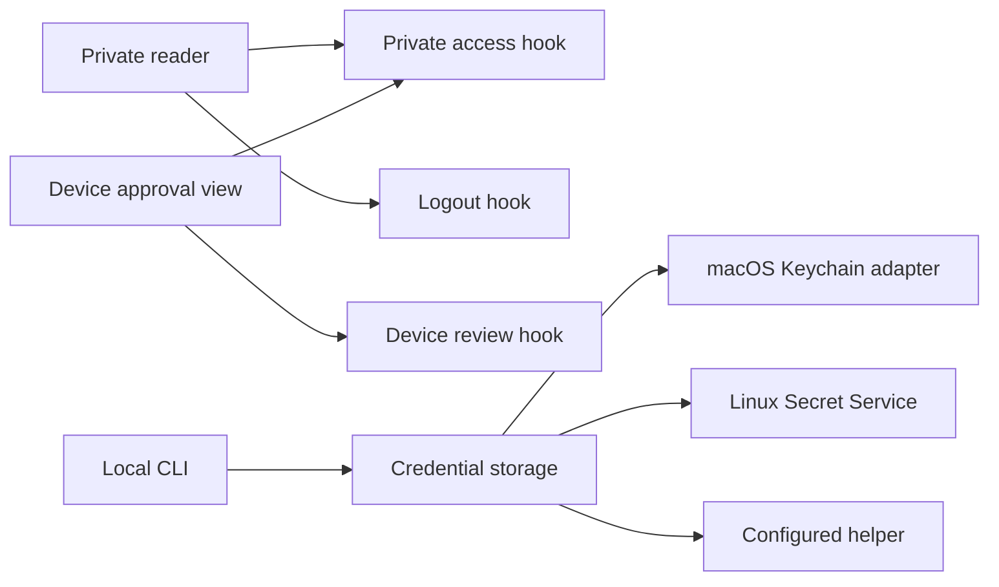

# Focused tour hooks and local Keychain storage

A local author can now run the Anaphor CLI on macOS without supplying a custom
credential helper. The browser keeps its existing reading and approval behavior,
with session lifetime, logout and device review owned by focused hooks that their
views compose. This follows [PR #43](https://github.com/danfrenette/anaphor/pull/43)
at `9942e7e`; it does not replace that review baseline or launch production.

A **private tour** is an owner-only explanation at a stable URL. A **device
request** asks the owner to approve a CLI in the browser. **Private access** lasts
only for the authenticated session in its selected environment.

## Reading until private access ends

The tour route passes its authorized initial document and expiry to the private
reader. The [private-access module](../../apps/demo/features/tours/private-access.tsx)
creates the scoped query client and owns the terminal access state. Its hook
checks the session, uses the earlier initial/server expiry, and rechecks on focus.
An expired session or a denied query/mutation ends access; the view unmounts
private content and the provider clears the query cache. There is one cleanup
owner instead of separate timer, logout and provider clearing paths.

The [logout hook](../../apps/demo/features/tours/use-private-logout.ts) owns server
revocation and its recovery message. Even if revocation fails, local content is
hidden and a working retry remains available. Successful revocation refreshes
the route. The [reader view](../../apps/demo/features/tours/private-tour.tsx)
composes both hooks and keeps explicit tour refresh close to the displayed tour.
No background tour polling or session renewal was added.

## Reviewing a device request

The [device-review hook](../../apps/demo/features/tours/use-device-review.ts) keeps
editing, review, decision and completion state together. The
[approval view](../../apps/demo/features/tours/device-approval.tsx) renders that
state. Editing a code changes the reviewed request's query key and clears the
completion text. While a decision is pending, code editing and decision buttons
remain disabled. Server authorization and the existing atomic decision regression
still protect the actual grant; this refactor does not implement another protocol.

The named views import their hooks directly. There is no forwarding browser
module, generic request framework or hook for each individual field. Cohesive
reader rendering, document validation and Better Auth configuration stay intact.

## Logging in from a Mac

The [CLI](../../apps/demo/features/tours/cli.ts) calls the
[credential-storage module](../../apps/demo/features/tours/secure-store.ts).
An explicit `ANAPHOR_SECURE_STORE` helper takes precedence. Otherwise macOS uses
[the native adapter](../../apps/demo/features/tours/macos-keychain.ts), while Linux
continues to use `secret-tool`. Other environments still need their configured
secure store.

The macOS adapter dynamically loads pinned
[`@napi-rs/keyring` 2.1.1](https://github.com/Brooooooklyn/keyring-node), installed
with the workspace. It stores credential JSON under service
`dev.anaphor.private-tours` and the exact origin. Credentials travel in process
memory, not shell arguments. Native error details are replaced with recovery
guidance. Missing native dependencies or denied access fail without downloading
anything or writing a plaintext fallback. Normal installation must retain the
platform's optional native package; this approach avoids a local Swift build.

Storage owns persistence only. The CLI still validates the credential's origin
and lifetime. A failed save revokes the new session when possible. Logout first
confirms server revocation, then removes the credential, reporting either failure
accurately. An old helper remains usable through the explicit override.

The diagram maps ownership; it is not execution evidence.

## Verification and limits

Implementation revision: `9e2023354d66252b77a614096b99dd2a60ba1aa6`, based on
`9942e7ed64dfbeb7dfd97b4a8962f9ab789d2ff6`. The following checks were executed on
2026-10-13; documentation-only follow-up retains that source provenance.

- Lint, strict TypeScript and 161 tests passed. The real Keychain check is opt-in
  and skipped in the ordinary suite.
- The explicitly enabled [native test](../../apps/demo/features/tours/macos-keychain.native.test.ts)
  passed on Apple Silicon macOS: write, replace, read, isolate two origins and
  delete disposable fictional credentials. Three deterministic storage tests also
  passed. Native denial diagnostics were substituted, not an actual OS denial.
- Five focused browser tests passed through hook consumers and the actual device
  view: fixed expiry, denied access on focus, failed logout/retry, edited-code
  review and denial completion. Network/router/time substitutes are disclosed in
  those tests; the real query client and hooks run.
- The unchanged [private-tour suite](../../e2e/tours.spec.ts) passed 19 checks with
  3 existing viewport-related skips in Chromium and WebKit. Its identity fixture
  replaces external provider login; its CLI processes and application are real.
- Agent-browser 0.39.0 approved a local CLI request without a custom helper. A new
  CLI process published from native Keychain storage, unchanged retry returned the
  same UUID, the reader retained content after navigation/reload, browser sign-out
  hid it, and CLI logout removed the credential. A subsequent publication process
  failed for missing credentials. This used isolated Postgres and a fictional
  owner identity, not a fresh Google/GitHub authorization.
- Independent Button and full-UI registry consumers installed, built and passed
  interaction/theme/font checks. No visual baselines were updated.

The PR records the full public-browser and CI results separately from the focused checks above. Standards,
Spec, Principles, Execution, Security and applicable concurrency/migration reviews
found no blocking implementation issue. Review is separate from runtime proof.

No server schema, checkpoint, production, OAuth configuration or deployment
binding changed. The native adapter was exercised on Apple Silicon; Intel binary
support is declared upstream but was not executed here. Missing secure remote
storage and production-domain launch remain the separate ANAPHOR-255–257 tracks.
The earlier preview provider evidence belongs to PR #43, not a new OAuth check.

## Review and rollback

Review the access-ending path and failure recovery before rearranging the hooks
further. Keep the CLI's server-revocation ordering separate from storage mechanics.
The existing browser/CLI harness was retained; only feature-test discovery was
added. [The verification recipe](../verification/private-tours.md) contains the
native opt-in and local CLI procedure.

There is no database migration. Reverting restores the previous macOS requirement
for a custom helper; it does not automatically revoke or remove credentials created
by this version. Log out before reverting, or retain the configured compatible
helper to revoke and clean up the origin's credential. Reverting the browser
extraction restores the baseline module organization and behavior.
